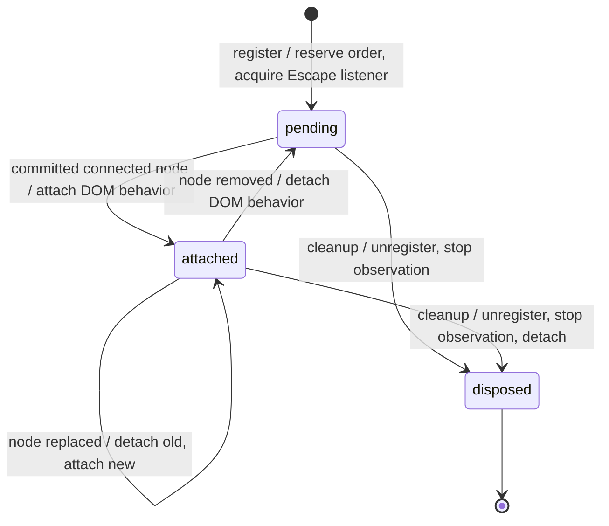

# Dismissable layer lifecycle

An open layer participates in Escape handling immediately. Its DOM attachment must not determine its identity or its
position in the stack. This resolves the conflicting timing requirements in #3248, #3323 and #3483.

## Anatomy and API

The existing trigger, content, positioner and backdrop parts do not change.
`trackDismissableElement(getContent, options)` still returns a cleanup function. The additive `getRootNode` option
supplies the machine's scope before content exists; every machine that tracks a dismissable element passes
`scope.getRootNode`. Standalone callers can omit it for the main document, or when an existing node supplies the owner
document. `trackDismissableBranch` does not need it, since branches are resolved at event time.

The internal registration is a stable `Layer` object with a required owner document. Its `node` is null while pending.
The stack accepts either a registration or an attached node for existing queries; lifecycle cleanup always uses the
registration's identity.

## States and transitions

| Event                     | Pending                                | Attached                                 | Disposed  |
| ------------------------- | -------------------------------------- | ---------------------------------------- | --------- |
| Escape                    | Invoke the document's top registration | Same                                     | Ignore    |
| Connected content appears | Attach without moving the registration | Replace only if identity changed         | Ignore    |
| Content disappears        | Keep waiting                           | Detach; retain registration and order    | Ignore    |
| Parent layer removed      | Call `dismiss()` directly              | Fire preventable `layer:request-dismiss` | Ignore    |
| Cleanup                   | Unregister and cancel observation      | Unregister and detach                    | No action |

Escape requests dismissal; it does not itself dispose a registration. This preserves controlled overlays and consumers
that prevent dismissal. The machine leaving its open state owns cleanup.

## Ordering and Escape

- Reserve the registration synchronously, in machine effect order, before resolving committed content.
- Use a single reference-counted capture listener per owner document. Select its top registration once per key event;
  synchronous dismissal must not deliver that same event to the newly exposed parent.
- Preserve composition handling and `onEscapeKeyDown` prevention. A pending child shields its parent from Escape just as
  an attached child does.
- Attaching, detaching or replacing content does not reorder or remove the registration, and does not dismiss children.
- Separate documents have independent top registrations, nesting metadata and pointer blocking. Layers in the same
  document, including shadow roots, share Escape arbitration.
- Nesting is inferred from opening order, not from an ownership tree. Removing a layer dismisses the layers opened after
  it in the same document.

## DOM attachment

`observeNode` observes the lookup root for child-list and id mutations. With `defer: true`, its initial read waits until
a microtask to avoid capturing content replaced during the opening commit. It remains subscribed until cleanup so late
mounts and later portal replacements are handled without a frame deadline. A frame is used only for the missing-node
diagnostic, never for Escape registration or node discovery.

It uses `dom-query`'s `createSharedMutationObserver(options)`, which shares one native observer per target and
normalized configuration. A shadow root or element scope also subscribes to the owner document so connecting or removing
its host is detected. Each subscription releases independently; the last release disconnects the observer.
`observeAttributes` uses the same pool. `observeChildren` keeps a dedicated observer because its public callback
receives the native observer.

Attachment applies layer CSS metadata, pointer blocking and style targets, and installs outside-interaction tracking. A
pending modal does not block pointer events on the page before it has content. Persistent elements are observed the same
way. Branches are stored as getters and resolved when an outside interaction is checked, so they need no observation.

The body lock is stored on the document under a `Symbol.for` key with a set of owners, so duplicate copies of this
package share it: the first owner records the original `pointer-events`, and the last one to unblock restores it.

Stale outside callbacks check registration membership and node identity before invoking consumers. Disposal cancels
observation and warnings; a later insertion cannot resurrect the layer. Repeated cleanup is harmless.

## Outside interactions

`trackInteractOutside` adds its `pointerdown` listeners as soon as tracking starts, so a press during a busy frame is
not dropped. A press whose `timeStamp` predates tracking belongs to the gesture that opened the component and is
ignored; timestamps are compared against each window's `timeOrigin` so frame events work too.

Focus tracking keeps its deferral: with `defer`, `focusin` listeners wait a frame so focus can settle after opening, and
they are skipped on touch devices. Touch presses still dismiss on the following `click`, so scrolling does not dismiss.
The per-event frame before checking a mouse target is unchanged.

## Floating position

Floating styles keep a newly mounted positioner offscreen until its `--x` and `--y` coordinates exist. A placement name
can be available before the deferred calculation runs; it alone must not expose content at the page origin. With
`applyStyles: false`, consumers own the coordinates and the original transform is kept.

## Scope

This covers dismissable registration, attachment and outside-interaction timing. Initial focus, focus trapping and aria
hiding keep their existing scheduling. Known gaps: a layer leaves the stack while its exit animation still runs, and a
layer portalled into another document receives Escape from its scope's document.
